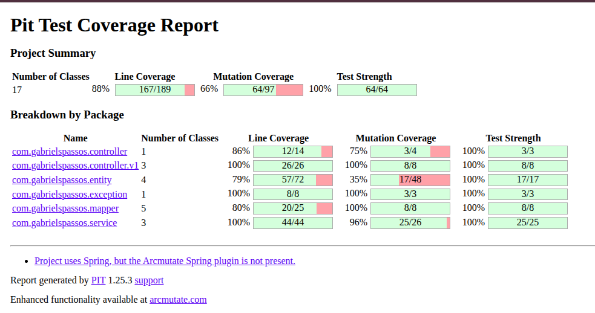
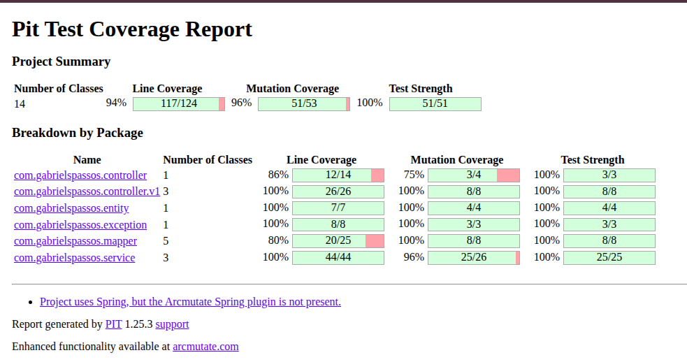

# Todo List API - Testing POC

A RESTful To-Do List application built with Java and Spring Boot. This project serves as a practical Proof of Concept (POC) demonstrating a multi-layer testing strategy, including **Unit**, **Contract**, **Integration** (using Testcontainers), and **Mutation** testing (using PITest).

---

## Tech Stack

- **Java**: 26
- **Framework**: Spring Boot 4.1.2
  - `spring-boot-starter-webmvc` (REST APIs)
  - `spring-boot-starter-data-jdbc` (Data persistence)
  - `spring-boot-starter-validation` (Bean validation)
- **Database**: PostgreSQL
- **Build Tool**: Apache Maven (Maven Wrapper included)
- **Testing & Quality**:
  - **JUnit 5** & **Mockito**: Unit testing and mocking
  - **Spring MockMvc**: Controller and contract testing
  - **Testcontainers**: Containerized PostgreSQL for isolated integration testing
  - **PITest**: Mutation testing for measuring test suite quality

---

## API Endpoints

All endpoints are versioned under `/v1`.

### Users

| Method | Endpoint | Description | Request Body | Response Status |
|---|---|---|---|---|
| `POST` | `/v1/users` | Create a new user | `{"name": "user-name"}` | `201 Created` |
| `GET` | `/v1/users?name={name}` | Retrieve a user by username | _None_ (Query param `name`) | `200 OK` / `404 Not Found` |

### Lists

| Method | Endpoint | Description | Request Body | Response Status |
|---|---|---|---|---|
| `POST` | `/v1/users/{userId}/lists` | Create a new list for a user | `{"name": "list-name"}` | `201 Created` / `404 Not Found` |
| `GET` | `/v1/users/{userId}/lists` | Retrieve the list of a user | _None_ | `200 OK` / `404 Not Found` |

### Items

| Method | Endpoint | Description | Request Body | Response Status |
|---|---|---|---|---|
| `POST` | `/v1/lists/{listId}/items` | Create an item in a list | `{"description": "Buy groceries"}` | `201 Created` / `404 Not Found` |
| `GET` | `/v1/lists/{listId}/items` | Get all items belonging to a list | _None_ | `200 OK` |
| `PUT` | `/v1/items/{itemId}` | Update item status (`TO_DO`, `DONE`) | `{"status": "DONE"}` | `200 OK` / `400 Bad Request` / `404 Not Found` |
| `DELETE` | `/v1/items/{itemId}` | Delete an item by ID | _None_ | `204 No Content` / `404 Not Found` |

---

## Testing Strategy

This project focuses on high test quality and coverage across multiple levels:

1. **Unit Tests**:
   - Located in `src/test/java/com/gabrielspassos/service/`.
   - Test business logic (e.g., `ItemServiceTest`) in isolation using JUnit 5 and Mockito.

2. **Contract Tests**:
   - Located in `src/test/java/com/gabrielspassos/controller/v1/*ContractTest.java`.
   - Validate API contracts and serialization against JSON schemas/fixtures in `src/test/resources/*.json` using `MockMvc` and `@MockitoBean`.

3. **Integration Tests**:
   - Located in `src/test/java/com/gabrielspassos/controller/v1/*IntegrationTest.java`.
   - End-to-end API tests running against a real PostgreSQL instance started automatically using **Testcontainers** (`schema.sql` initialization).

4. **Mutation Tests (PITest)**:
   - Injects mutants (code mutations) into compiled classes to verify test suite efficacy.
   - Configured via `pitest-maven` targeting `com.gabrielspassos.*` with an 80% mutation score threshold.

---

## Running the Project & Tests

### Prerequisites
- Java 26
- Docker (required for Testcontainers during integration tests)

### Running the Application
```bash
./mvnw spring-boot:run
```

### Running Tests
To run all Unit, Contract, and Integration tests:
```bash
./mvnw clean install
# or
./test.sh
```

### Running Mutation Tests
To execute mutation analysis and generate an HTML report under `target/pit-reports`:
```bash
./mvnw test-compile org.pitest:pitest-maven:mutationCoverage
# or
./test-mutation.sh
```

#### Mutation Test Reports
Mutation testing ensures assertions actually detect bugs. Below is the evolution of the mutation test report:

- **Baseline Run**:
  

- **Tuned & Strengthened Suite**:
  
